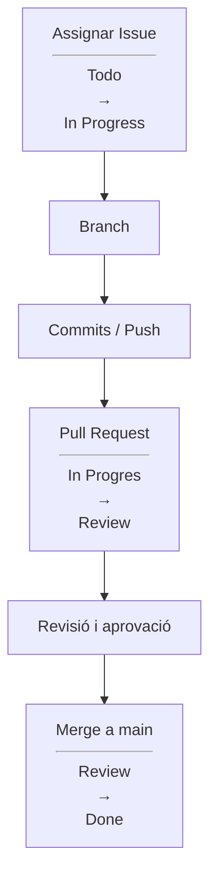

# Guia del Projecte per a l'Alumnat · Gestió Col·laborativa amb GitHub

Benvinguts al **Projecte 1**. En aquesta activitat aprendreu a treballar com un equip de desenvolupament de programari real utilitzant **Git i GitHub** (repositoris, branques, *commits*, *Pull Requests*, *Issues* i taulers Kanban) per a construir i documentar una botiga en línia (**TechShop**).

---

## 1. En què consisteix el projecte?

No haureu de dissenyar ni programar l'aplicació des de zero. El professorat us proporciona el producte base i les especificacions de cada fase perquè us centreu en **com s'organitza, es versiona, es revisa i s'integra el treball en equip**:

* Organitzar i fer seguiment de les tasques en un **tauler Kanban (GitHub Projects)**.
* Treballar de manera aïllada amb **branques (*branches*)** sense modificar directament `main`.
* Registrar canvis amb ***commits* clars** i sincronitzar-los (`push` / `pull`).
* Integrar cada tasca mitjançant una ***Pull Request* (PR)** revisada i aprovada per un company (*Peer Review*).
* Resoldre **conflictes d'integració** quan dues persones editen el mateix fitxer.
* Mantenir la **documentació tècnica** (Markdown i diagrames Mermaid) sota el mateix control de versions que el codi.
* Publicar la versió final del producte mitjançant una ***Release*** formal a GitHub.

---

## 2. Organització del treball

* **Equips:** grups d'entre 3 i 5 persones (recomanat: **4 persones**).
* **Duració:** **16 hores** lectives (8 sessions de 2 hores).
* **Repartiment:** **16 tasques xicotetes** distribuïdes en **4 etapes progressives** (orientativament **4 tasques per persona**, una en cada etapa).
* **Tothom fa de tot:** no hi ha rols fixos. Al llarg del projecte, cada membre de l'equip haurà de fer tasques de codi, redactar documentació en Markdown, elaborar diagrames amb Mermaid, revisar *Pull Requests* de companys i participar en la resolució de conflictes.
* **Lliurament:** abans de l'avaluació. **No hi haurà presentacions orals**: tota la qualificació s'obtindrà de l'activitat registrada a GitHub.

---

## 3. Flux de treball obligatori en GitHub

Tota tasca del projecte (ja siga de codi o de documentació) ha de seguir sempre aquest cicle complet per a garantir la traçabilitat:

> [!IMPORTANT]
> **Tres regles fonamentals:**
> 1. **Mai es treballa directament sobre la branca `main`.**
> 2. **Cap alumne pot aprovar ni fusionar (*merge*) la seua pròpia *Pull Request***; sempre l'ha de revisar un altre membre de l'equip.
> 3. **La documentació tècnica es gestiona exactament igual que el codi** (amb la seua *Issue*, branca, *commits* i *Pull Request*).

---

## 4. Les 4 Etapes del Projecte

El treball s'estructura en un punt de partida i quatre etapes amb autonomia creixent. Entreu a la carpeta de cada etapa quan us ho indique el professorat:

| Etapa | Sessions | Tasques | Què hi fareu? |
|---|---|---|---|
| 🚀 **[Punt de Partida (`etapa0-inicial/`)](etapa0-inicial/README.md)** | Sessió 1 | Inicialització | Explorar el repositori inicial, configurar els col·laboradors i preparar el tauler Kanban. |
| 🟢 **[Etapa 1 (`etapa1/`)](etapa1/README.md)** | Sessions 2, 3 i 4 | Tasques 1 a 4 | **Nivell bàsic:** aprendre el flux complet de GitHub amb tasques guiades pas a pas. |
| 🟡 **[Etapa 2 (`etapa2/`)](etapa2/README.md)** | Sessions 5 i 6 | Tasques 5 a 8 | **Nivell intermedi:** completar codi incomplet, ampliar la documentació i resoldre un conflicte en Git. |
| 🟠 **[Etapa 3 (`etapa3/`)](etapa3/README.md)** | Sessió 7 | Tasques 9 a 12 | **Descomposició:** analitzar una funcionalitat gran en equip i subdividir-la en 4 subtasques al Kanban. |
| 🔴 **[Etapa 4 (`etapa4/`)](etapa4/README.md)** | Sessió 8 | Tasques 13 a 16 | **Autonomia i tancament:** completar els requisits finals, auditar el repositori i publicar la *Release* `v1.0.0`. |

---

## 5. Avaluació

L'avaluació es basa exclusivament en les **evidències observables que deixeu registrades a GitHub**, combinant el resultat global del grup i el treball individual de cada estudiant:

### Avaluació d'equip i individual
* **Treball de l'equip:** ordre i funcionament del repositori final, tauler Kanban actualitzat amb les 16 tasques a `Done`, completitud dels **6 elements de documentació tècnica** (descripció, diagrames Mermaid, model de dades, casos d'ús, guia de contribució i tecnologies), absència de conflictes pendents i publicació de la *Release* `v1.0.0`.
* **Treball individual:** participació real i equilibrada de cada membre a GitHub (~4 tasques completades, branques creades, qualitat dels missatges de *commit*, *Pull Requests* obertes i revisions tècniques fetes als companys).

### Criteris d'avaluació (C1 - C8)
| Criteri | Evidència a GitHub |
|---|---|
| **C1. Gestió de tasques i Kanban** | *Issues* ben definides (responsable, etiqueta, *milestone*), descomposició d'etapes 3-4 i targetes al dia en GitHub Projects. |
| **C2. Control de versions en branques** | Ús de branques temàtiques per tasca, cap *commit* directe a `main` i missatges de *commit* descriptius. |
| **C3. Integració i revisió per parelles** | *Pull Requests* vinculades a la seua *Issue* i revisades amb comentaris i aprovació d'un company. |
| **C4. Documentació tècnica versionada** | Els 6 documents obligatoris en Markdown i diagrames Mermaid integrats mitjançant branques i PRs. |
| **C5. Resolució de conflictes** | Resolució consensuada i neta de conflictes d'edició concurrent sense pèrdua de codi ni de documentació. |
| **C6. Traçabilitat integral** | Connexió clara en tot el cicle: `Requisit → Issue → Branca → Commits → PR → Review → Merge`. |
| **C7. Participació individual equilibrada** | Activitat constant de cada alumne tant creant les seues ~4 tasques com revisant les dels companys. |
| **C8. Entrega final i Release** | Repositori funcional, 16 tasques tancades, historial net i versió final etiquetada i publicada com a *Release*. |

Cada criteri es valorarà en quatre nivells: **4 · Consolidat** (autònom i rigorós), **3 · Adequat** (correcte amb xicotetes correccions), **2 · En desenvolupament** (amb ajuda freqüent o errors d'integració) i **1 · Inicial** (no aplica el flux).
