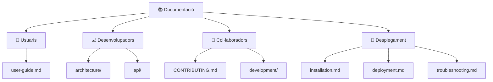

# Tasca 2 · Descripció General del Projecte i Índex de Documentació

* **Etapa:** Etapa 1 (Nivell Bàsic)
* **Tipus de tasca:** Documentació tècnica en Markdown (Element obligatori 1: *Descripció del projecte*)
* **Branca de treball:** `docs/2-descripcio-projecte`
* **Fitxers a crear/modificar:** `projecte/README.md` i `projecte/docs/README.md`

---

## 1. Objectiu de la Tasca

Elaborar la porta d'entrada documental del projecte seguint l'estàndard de **quatre públics** (*Usuaris, Desenvolupadors, Col·laboradors i Desplegament*):
1. Completar el fitxer principal `projecte/README.md` amb l'objectiu, l'abast, les 5 funcionalitats principals, les vistes de pantalla en text, les instruccions d'execució amb Java 25 i la taula de correspondència dels 6 elements documentals.
2. Crear el fitxer `projecte/docs/README.md` amb el diagrama Mermaid de navegació documental i l'arbre complet de `docs/`.

---

## 2. Instruccions Pas a Pas

### Pas 1: Crea i activa la teua branca
```bash
git switch main
git pull origin main
git switch -c docs/2-descripcio-projecte
```

### Pas 2: Redacta `projecte/README.md`
Substitueix el contingut provisional de `projecte/README.md` per una guia completa que incloga les seccions següents:

1. **Títol, insígnies (*badges*) i descripció del projecte:**
   * Explicar que **TechShop** és una aplicació interactiva de consola per a gestionar una botiga d'informàtica i tecnologia, dissenyada per a alumnat de **1r de FP d'Informàtica** utilitzant tipus primitius, `String`, vectors paral·lels i classes implícites de **Java 25**.
2. **Taula de les 5 funcionalitats principals:**
   * `👥 Gestió de clients`: directori interactiu, cerca per qualsevol camp (ID, nom, correu o telèfon), fitxa amb historial de compres, alta, modificació i baixa lògica (`ACTIU` / `BAIXA`).
   * `📦 Catàleg i estoc`: llistat amb barra visual d'estoc i etiquetes (`EN ESTOC`, `BAIX`, `ESGOTAT`), cerca per ID/nom/categoria, alta, modificació, reposició i eliminació física.
   * `💳 Vendes i facturació`: targetes d'estadístiques (`Math.max`, `Math.min`, mitjana i total), historial, cerca, registre de venda amb descompte d'estoc i emissió de tiquet amb codi aleatori (`Random`).
   * `💾 Persistència de dades`: lectura automàtica en iniciar i guardat manual en `projecte/dades_botiga.txt` amb `Files.readString` i `Files.writeString`.
   * `🎨 Interfície ANSI`: taules Unicode (`╭─┬─╮`), targetes KPI i missatges amb colors aïllats exclusivament als mètodes d'interfície.
3. **Vistes de l'aplicació (captures de terminal en blocs `text`):**
   * Executar `java projecte/Main.java`, copiar l'eixida del panell de control principal i mostrar com es veu la taula del menú i les targetes de resum.
4. **Execució ràpida:**
   * Requisits: **JDK 25+**, terminal UTF-8 amb suport ANSI.
   * Ordre d'execució des de l'arrel del repositori:
     ```bash
     java projecte/Main.java
     ```
5. **Documentació per a quatre públics i Taula dels 6 elements documentals:**
   * Enllaçar a `docs/user-guide.md`, `docs/architecture/overview.md`, `docs/architecture/data-model.md`, `docs/architecture/diagrams.md`, `docs/api/README.md`, `CONTRIBUTING.md`, `docs/installation.md`, `docs/deployment.md` i `docs/troubleshooting.md`.

### Pas 3: Crea `projecte/docs/README.md`
Crea el directori `projecte/docs/` (si no existeix) i redacta `projecte/docs/README.md` amb l'estructura següent:

````markdown
# 📚 Índex de la Documentació · Botiga en Línia

Aquesta és la porta d'entrada a la documentació del projecte. S'organitza per a **quatre públics**, seguint les recomanacions de documentació de programari de Google i *source{d}*.

> [!TIP]
> Tota la documentació és Markdown dins del mateix repositori. Els diagrames són **Mermaid** i GitHub els dibuixa automàticament. Es revisa i es versiona igual que el codi: cada canvi passa per una *pull request*.

---

## 🎯 Tria el teu camí



---

### 👤 Usuaris
| Document | Contingut |
| :--- | :--- |
| 📖 [Manual d'usuari](user-guide.md) | Casos d'ús i ús pas a pas de cada pantalla: clients, catàleg, vendes, desar i eixir. |

### 💻 Desenvolupadors
| Document | Contingut |
| :--- | :--- |
| 🏛️ [Arquitectura i tecnologies](architecture/overview.md) | Organització de `Main.java`, responsabilitats de cada part, tecnologies i restriccions didàctiques. |
| 🗄️ [Model de dades](architecture/data-model.md) | Vectors paral·lels, relacions entre entitats, regles de les dades i format del fitxer. |
| 📊 [Diagrames](architecture/diagrams.md) | Arquitectura, casos d'ús, model de dades, navegació i flux d'una venda. |
| 📚 [Referència de mètodes](api/README.md) | Índex dels mètodes de `Main.java` agrupats per mòdul. |

### 👥 Col·laboradors
| Document | Contingut |
| :--- | :--- |
| 🤝 [Guia de contribució](../CONTRIBUTING.md) | Normes del codi, branques, *commits*, *pull requests*, revisió i documentació obligatòria. |
| ⚙️ [Flux de treball](development/workflow.md) | Cicle d'una tasca amb Kanban, branques i *pull requests*, i com resoldre conflictes. |
| 🧪 [Proves](development/testing.md) | Proves amb canonades (`printf ... \|`) i casos de prova manuals. |
| 💻 [Entorn de desenvolupament](development/environment.md) | JDK, editor i terminal recomanats. |

### 🚀 Desplegament
| Document | Contingut |
| :--- | :--- |
| 🛠️ [Instal·lació](installation.md) | Requisits i primera execució en Linux, Windows i macOS. |
| 🚢 [Desplegament i manteniment](deployment.md) | Execució a l'aula, fitxer de dades, còpies de seguretat i actualització. |
| 🔧 [Resolució de problemes](troubleshooting.md) | Errors freqüents i com solucionar-los. |
````

*(Afegeix al final l'arbre en text del directori `docs/`).*

---

## 3. Criteris d'Acceptació (*Definition of Done*)

- [ ] `projecte/README.md` descriu l'objectiu, les 5 funcionalitats, l'execució amb `java projecte/Main.java`, captures en text i l'índex per audiències.
- [ ] `projecte/docs/README.md` inclou el diagrama Mermaid dels 4 públics i les taules d'enllaços relatius.
- [ ] Els documents utilitzen sintaxi Markdown neta (taules alineades, blocs de codi tancats i alertes `> [!TIP]`).
- [ ] S'ha fet *commit* (`docs(readme): afegeix descripcio general del projecte i index documental`), *push* i obert la *Pull Request* vinculada a la *Issue* #2.
